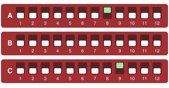

# Antlantec GmbH – Temperaturmanagement für einen Serverschrank

Schulprojekt | ESP32 und Joy-Pi Advanced

## Gruppenmitglieder

- Sven Salwender
- Mark Fröhlich

## Projektziel

Ziel des Projekts ist ein Prototyp für die automatische, temperaturabhängige Lüfteransteuerung eines Serverschranks. Dazu wird die aktuelle Temperatur gemessen und mit einer einstellbaren Solltemperatur verglichen. Beide Werte sowie die aktuelle Lüfteransteuerung werden auf einem LCD angezeigt. Durch bedarfsgerechte Belüftung soll unnötiger Energieverbrauch vermieden werden. Eine vollständige Ersetzung der Raumklimatisierung ist mit dem Prototyp allein nicht nachgewiesen.

## Hardware

| Komponente | Aufgabe |
| --- | --- |
| NodeMCU ESP32 mit Joy-Pi-Adapter | Messung auswerten, Sollwert verarbeiten und PWM erzeugen |
| Joy-Pi Advanced | Integrierte Entwicklungsplattform mit Sensoren und Aktoren |
| DHT11 | Digitale Temperaturmessung |
| LCD 16 × 2 (I²C, 0x21) | Istwert, Sollwert und PWM-Ansteuerung anzeigen |
| 4 × 4 Tastenmatrix mit MCP23008 (I²C, 0x22) | Sollwert mit `+` und `-` ändern |
| Integrierter PWM-Lüfter mit Treiber | Luftaustausch simulieren |

## Aufbau und Demonstration

Das erste Bild zeigt den Anschlussplan der Lüftersteuerung. Das zweite Bild dokumentiert die relevanten Kippschalter: A8 ist für den Lüfter und C9 ist für den DHT11.

https://github.com/user-attachments/assets/f65f16b4-3457-4342-ade0-e3ea652c11af

[Demonstrationsvideo als MP4 herunterladen](media/Demo-Video.mp4?raw=true)

### Foto des Aufbaus

Zum Einfügen eines eigenen Fotos: Legen Sie das Bild als `media/aufbau.jpg` ab und aktivieren Sie die folgende Zeile:

<!--  -->

## Schaltplan und Pinbelegung

Der Anschlussplan zeigt die logischen Verbindungen auf dem Joy-Pi Advanced. Da die Komponenten auf der Platine integriert sind, werden interne Treiberschaltungen, Widerstände und Versorgungspfade nicht als diskrete Bauteile dargestellt. Grundlage sind der vorhandene Quellcode und die Pinbelegung der Herstelleranleitung (31.10.2023, Abschnitt 3 „Sensorik“). Die tatsächlichen Schalterstellungen sind am eigenen Gerät abzugleichen.

| ESP32 | Joy-Pi-Zuordnung | Funktion |
| --- | --- | --- |
| GPIO 14 | P7, Switch A8 | PWM-Ausgang zum integrierten Lüftertreiber |
| GPIO 17 | P8, Switch C9 | DHT11-Datenleitung |
| GPIO 21 | SDA | Gemeinsamer I²C-Datenbus |
| GPIO 22 | SCL | Gemeinsamer I²C-Taktbus |
| GND | Gemeinsame Masse über Platine/Adapter | Bezugspotential |

Für den integrierten Lüfter A8 und für den DHT11 C9 aktivieren. B8, C8, A9 und B9 deaktivieren, um Doppelbelegungen zu vermeiden. LCD und Tastenmatrix sind bereits am I²C-Bus angeschlossen und benötigen keine eigenen DIP-Schalter. Für den ESP32-Adapter ist der Boardconnector Extern vorgesehen. Die Spannungsversorgung erfolgt über den vorgesehenen Joy-Pi-Aufbau; der Motor wird nicht direkt vom GPIO versorgt.

Die Tastenmatrix wird über den MCP23008 abgefragt: GP0–GP3 sind die Zeilen, GP4–GP7 die Spalten mit internen Pull-ups (Zuordnung laut Quellcode).

## Funktionsbeschreibung

Nach dem Einschalten beträgt die Solltemperatur 26,5 °C. Bis zum ersten gültigen Messwert wird der Lüfter mit 100 % PWM angesteuert. Der DHT11 liefert alle zwei Sekunden einen neuen Temperaturwert. Die Anzeige wird alle 250 ms aktualisiert. Die Solltemperatur lässt sich mit `+` und `-` in Schritten von 0,5 °C zwischen 15 und 40 °C einstellen. Die übrigen Tasten verändern den Sollwert nicht. Der Sollwert wird nicht dauerhaft gespeichert.

Die Lüfteransteuerung wird aus der Isttemperatur berechnet. Die Abschaltgrenze liegt 1 °C unter dem Sollwert; die obere Grenze liegt 2 °C darüber. Dazwischen wird eine lineare Kennlinie über einen Bereich von 3 °C berechnet. Sobald Kühlbedarf besteht, wird mindestens 40 % PWM vorgegeben. Ab der oberen Grenze werden 100 % ausgegeben.

Die PWM-Frequenz wird auf 1.000 Hz eingestellt. Der Wertebereich beträgt 0 bis 255; 102 entspricht 40 % und 255 entspricht 100 %. Beim Anlaufen aus dem Stillstand erhält der Lüfter bei weiter bestehendem Bedarf für 500 ms einen Impuls mit 100 %. Danach wird die Ansteuerung schrittweise angepasst (ein PWM-Schritt pro 20 ms). Beim Abschalten springt die Ausgabe von der Mindestansteuerung auf 0 %. Die Anzeige zeigt den tatsächlich ausgegebenen PWM-Wert in Prozent, nicht die gemessene Drehzahl.

### Beispiel für den Start-Sollwert von 26,5 °C

| Isttemperatur | PWM-Zielwert (Anzeige gerundet, nach der Rampe) |
| --- | ---: |
| 25,0 °C | 0 % |
| 25,5 °C | 0 % |
| 26,0 °C | 40 % |
| 26,5 °C | 40 % |
| 27,0 °C | 50 % |
| 28,0 °C | 83 % |
| 28,5 °C und höher | 100 % |

Die Kennlinie ist temperaturabhängig und enthält keine separate Ein- und Ausschalthysterese. Die Mindestansteuerung und die Rampe begrenzen bzw. glätten die Ausgabe. Bei unverändertem Zielwert dauert eine Rampe von 100 % auf 40 % etwa 3,1 s. Die Werte sind aus dem Code berechnet und keine Messdaten.

### Fehlerbehandlung

Bei einem ungültigen Sensorwert (`NAN`) zeigt das LCD `Sensorfehler` an und der ESP32 gibt sofort 100 % PWM aus. Falls das LCD oder die Tastenmatrix bei der Initialisierung nicht erreicht wird, wird eine serielle Fehlermeldung ausgegeben und das Programm bleibt in einer Schleife mit der zuvor gesetzten 100-%-Ausgabe. Ein mechanischer Lüfterausfall wird nicht erkannt, da keine Drehzahlrückmeldung ausgewertet wird.

## Begründung der technischen Entscheidungen

- **ESP32:** Der Mikrocontroller bietet digitale Ein- und Ausgänge, I²C und PWM; damit lassen sich alle benötigten Module ansteuern.
- **Joy-Pi Advanced:** Die integrierten Komponenten vereinfachen den Aufbau und reduzieren den Verdrahtungsaufwand.
- **DHT11:** Der bereits vorhandene Sensor eignet sich für die Demonstration. Für einen echten Serverschrank wäre ein genauerer und ggf. redundant ausgelegter Sensor sinnvoll.
- **PWM statt reiner Ein-/Aus-Steuerung:** Die Lüfteransteuerung lässt sich an die Temperatur anpassen, wodurch potenziell Energie und Geräusche reduziert werden.
- **Mindestansteuerung und Anlaufimpuls:** Sie sollen einen zuverlässigen Anlauf unterstützen; die Eignung der Werte muss am tatsächlichen Lüfter getestet werden.
- **I²C:** LCD und Tastatur-Expander teilen sich zwei Signalleitungen und werden über unterschiedliche Adressen angesprochen.
- **Fehlerreaktion:** Bei einem ungültigen Messwert wird vorsorglich maximale Ansteuerung gewählt.

## Software und Inbetriebnahme

1. Arduino IDE mit ESP32-Boardpaket von Espressif verwenden. Das vorhandene Boardprofil und die funktionierende Core-Version beibehalten (`analogWriteFrequency` wird benötigt).
2. Die Bibliotheken aus [lib](lib/README.md) über die Bibliotheksverwaltung installieren oder die vollständigen Bibliotheksordner in den Arduino-Sketchbook-Ordner `libraries` kopieren. Ein `lib`-Ordner im Repository wird von der Arduino IDE nicht automatisch eingebunden.
3. [Lueftersteuerung.ino](code/Lueftersteuerung/Lueftersteuerung.ino) öffnen, das passende ESP32-Board und den USB-Port auswählen und den Sketch hochladen.
4. Joy-Pi mit den oben angegebenen Modulzuordnungen betreiben. Nach der Startmeldung Istwert, Sollwert und PWM-Anzeige prüfen.
5. Mit `+` oder `-` den Sollwert ändern und die Reaktion des Lüfters beobachten. Serielle Schnittstelle: 115200 Baud.

Verwendetes Boardprofil / ESP32-Core-Version: **[aus eurer Arduino IDE eintragen]**.

## Aufbau des Quellcodes

| Funktion | Aufgabe |
| --- | --- |
| `setup()` | PWM, Sensor, I²C, LCD und Tastenmatrix initialisieren |
| `loop()` | Tasten, Messintervalle, Regelung und Anzeige koordinieren |
| `leseTaste()` | Zeilen der Tastenmatrix nacheinander abfragen |
| `regleLuefter()` | PWM-Ziel berechnen, Fehler behandeln, Anlauf und Rampe steuern |
| `zeigeLCD()` | Istwert, Sollwert und PWM-Prozentwert anzeigen |

## Funktionstest

Die erwarteten Reaktionen und ein auszufüllendes Testprotokoll befinden sich in [docs/testprotokoll.md](docs/testprotokoll.md). Es wurden hier keine tatsächlichen Testergebnisse eingetragen.

## Grenzen und Ausblick

Der Prototyp demonstriert die Steuerung eines Lüfters anhand einer einzelnen Temperaturmessung. Eine reale Serverumgebung erfordert unter anderem eine geeignete Luftführung, ausreichend kühle Zuluft, eine thermische Auslegung, Übertemperaturalarm und Lüfterüberwachung. Ob auf die Raumklimatisierung verzichtet werden kann, ist gesondert unter realer Wärmelast zu prüfen.

## Quellen und Dokumentation

- [Datenblätter und Herstellerunterlagen](docs/README.md)
- [Verwendete Bibliotheken und Abhängigkeiten](lib/README.md)
- [Arduino-ESP32 PWM-API](https://docs.espressif.com/projects/arduino-esp32/en/latest/api/ledc.html)
- [Joy-Pi Advanced – Herstellerseite](https://joy-it.net/de/products/RB-JoyPi-Advanced)
